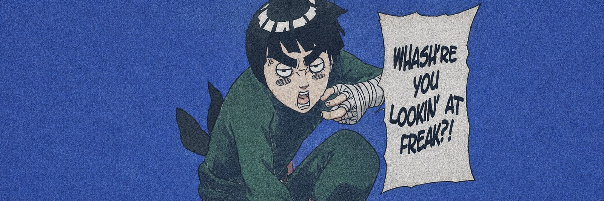
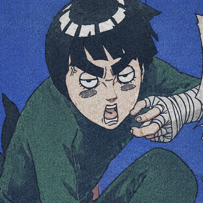

  <picture>
    <source media="(prefers-color-scheme: light)" srcset="assets/banner-ink.jpg">
    
  </picture>

  

  
  

<!-- ─────────────────────────── CHAPTER 01 ─────────────────────────── -->

<table align="center">
<tr>
<td width="38%" align="center">
  
</td>
<td width="62%" align="center">
  
</td>
</tr>
</table>

  

<!-- ─────────────────────────── CHAPTER 02 ─────────────────────────── -->

<table align="center">
<tr>
<td></td>
<td></td>
</tr>
<tr>
<td></td>
<td></td>
</tr>
<tr>
<td></td>
<td></td>
</tr>
</table>

<b>📚 Open the rest of the library</b>

 

| Arc | Volumes |
|---|---|
| 🔍 **On-chain intel** | [Onchain Times](https://onchain-times-mu.vercel.app) · [Trade Reflect](https://github.com/heil-kaizen/trade-reflect-codex) · [Trading Journal Extension](https://github.com/heil-kaizen/qwen-trading-jounaling-extension) · [Farming List](https://farming-list.vercel.app) |
| 🚀 **Launchpads & markets** | [StockWars](https://stockwars-rho.vercel.app) · [GasPad](https://gas-pad.vercel.app) · [Eliza Pad](https://eliza-pad.vercel.app) · [SpaceDrop](https://spacedrop-seven.vercel.app) · [GitPad](https://github.com/heil-kaizen/GitPad) |
| 🐸 **Memecoin worlds** | [KIKO World](https://kiko-eosin.vercel.app) · [Penguin Strategy](https://www.penguinstrategy.xyz/) · [Hoopers](https://hoopers-nu.vercel.app) · [Pippin Story](https://github.com/heil-kaizen/Pippin-Story) · [PumpBros](https://pumpbros-test.vercel.app) · [smash.fun](https://smashing-test.vercel.app) |
| 🎮 **Games & Poké** | [PokeOS](https://poke-os-ten.vercel.app) · [PokeGrails](https://pokegrails.vercel.app) · [Anime](https://anime-ten-iota.vercel.app) |
| 🧩 **Chrome extensions** | [GMGN Wallet Logger](https://github.com/heil-kaizen/GMGN-wallet-logger) · [Peppin PET](https://github.com/heil-kaizen/Peppin-PET) · [Alon Pet](https://github.com/heil-kaizen/Alon-Pet-Chrome-Extension) · [PumpFun Snowfall](https://github.com/heil-kaizen/PumpFun-Snowfall) |
| 🧪 **AI experiments** | [GLM: Gas Language Model](https://glm-gas-language-model.vercel.app) · [TLM](https://tlm-testicle-language-model.vercel.app) · [Revolutionary Agentic AI](https://github.com/heil-kaizen/Revolutionary-Agentic-AI) |
| 🛠️ **Tools & scripts** | [GitRaw Link](https://git-raw-link.vercel.app) · [Telegram Group Broadcaster](https://github.com/heil-kaizen/Telethon-Group-Message-Sender-Script) |

<!-- ─────────────────────────── CHAPTER 03 ─────────────────────────── -->

  

  
  
  
  

<!-- ─────────────────────────── CHAPTER 04 ─────────────────────────── -->

  
  

  

  

 

  

